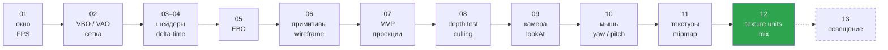

# Computer Graphics Coursework


От пустого окна до текстурированной 3D-сцены со свободной камерой — один и тот же рендерер,
который каждую неделю получает новый этап графического конвейера.

## Рос рендерера



## Недели

| # | Тема | Ключевое | Код |
|:-:|------|----------|----:|
| 01 | [Окно, фон, FPS](1-week) | GLFW, GLAD, цикл рендера | 143 |
| 02 | [Сетка с диагональным делением](2-week) | VBO, VAO, `glDrawArrays` | 230 |
| 03–04 | [Градиент и движение по окружности](3-4-week) | GLSL, uniform, delta time | 605 |
| 05 | [Индексный буфер](5-week) | EBO, `glDrawElements` | 330 |
| 06 | [Шар, прямоугольник, каркас](6-week) | генерация геометрии, `GL_LINE` | 278 |
| 07 | [Координаты, MVP, проекция](7-week) | model / view / projection, perspective vs ortho | 918 |
| 08 | [Глубина](8-week) | depth buffer, z-fighting, face culling | 698 |
| 09 | [Камера](9-week) | `lookAt`, WASD | 747 |
| 10 | [Мышь и свободная камера](10-week) | yaw / pitch, fov, scroll | 444 |
| 11 | [Текстуры](11-week) | UV, wrap, фильтрация, mipmap, анизотропия | 642 |
| 12 | [Несколько текстур](12-week) | texture units, `mix`, альфа-декаль, blend map | 545 |
| — | [СРС](srs) | самостоятельная работа | 357 |

<sub>Код — строки `.cpp` в папке недели.</sub>

## Демо

<details>
<summary><b>01</b> — Окно, фон, FPS</summary>


https://github.com/user-attachments/assets/f6865bf0-580e-4776-ad8c-6b3c7e91d9da


</details>

<details>
<summary><b>02</b> — Сетка с диагональным делением</summary>


https://github.com/user-attachments/assets/c91a904d-f24d-4844-bb62-a3617376e856


</details>

<details>
<summary><b>03</b> — Треугольник с градиентом цвета</summary>


https://github.com/user-attachments/assets/8dcaafc6-8d63-4332-a88e-cf28097b1eca


</details>

<details>
<summary><b>04</b> — Движение по окружности и delta time</summary>


https://github.com/user-attachments/assets/70ae5a42-e701-48cd-867d-5ba280fe969e


</details>

<details>
<summary><b>05</b> — Индексный буфер (EBO)</summary>


https://github.com/user-attachments/assets/c0967ac3-c183-46ba-bf97-88213ed80483


</details>

<details>
<summary><b>06</b> — Шар, прямоугольник и каркасный режим</summary>


https://github.com/user-attachments/assets/e8a4a4fa-dc1d-46c6-8fc2-864c9c88f9fa


</details>

<details>
<summary><b>07</b> — Координаты, MVP, проекция (3 задания)</summary>


https://github.com/user-attachments/assets/5cd95945-2677-411e-8f64-990d6905faa9


https://github.com/user-attachments/assets/4a54a062-c4ce-4ce7-98b2-bc60c54487bc


https://github.com/user-attachments/assets/988c976f-8cdc-4753-9fdf-7b2689393a1c


</details>

<details>
<summary><b>08</b> — Глубина и отсечение граней (3 задания)</summary>


https://github.com/user-attachments/assets/570183bd-267e-48c4-a520-3cae5ad65cc6


https://github.com/user-attachments/assets/621b344d-24e5-4cee-8ae8-e76e4e252a42


https://github.com/user-attachments/assets/02194ddb-eedb-47e6-8504-0e74043e083f


</details>

<details>
<summary><b>09</b> — Камера (3 задания)</summary>


https://github.com/user-attachments/assets/cf222fde-5bcd-48da-8999-4a68a342d963


https://github.com/user-attachments/assets/77110be5-f64f-40cc-b87a-4c18f63eee97


https://github.com/user-attachments/assets/d86b17cd-b005-4eb4-8fbc-9f9d2875f7ee


</details>

<details>
<summary><b>10</b> — Мышь и свободная камера</summary>


https://github.com/user-attachments/assets/533275c1-19dd-4829-b49c-e253c762d121


</details>

<details>
<summary><b>11</b> — Текстуры (5 заданий + дополнительные)</summary>

**1.** Режимы wrap: REPEAT / MIRRORED_REPEAT / CLAMP_TO_EDGE / CLAMP_TO_BORDER


https://github.com/user-attachments/assets/61ef626a-da13-42fa-8bd1-6bb2e0d8120d


**2.** NEAREST vs LINEAR


https://github.com/user-attachments/assets/9317f375-eaf8-4a93-a8a6-b7b44e5d5c19


**3.** Mipmap


https://github.com/user-attachments/assets/911226ae-c674-4dcd-8b0e-89e1b870a14e


**4.** Чёрный куб — текстура без mipmap-уровней


https://github.com/user-attachments/assets/e9cd07a9-0e2f-454c-89ba-18bf91dc39c3


**5.** Масштаб UV в шейдере


https://github.com/user-attachments/assets/10f72967-96c1-4e01-933a-8ed0632a49b4


**Дополнительные:** своя картинка, tint, текущая вода, анизотропия


https://github.com/user-attachments/assets/383ddba6-982a-48f8-9971-1d416929da29


</details>

<details>
<summary><b>12</b> — Несколько текстур (5 заданий + дополнительные)</summary>

**1.** Без `glActiveTexture` — обе текстуры в блоке 0


https://github.com/user-attachments/assets/7c81328e-2364-4a69-8364-7e058bf52677


**2.** ID текстуры вместо номера блока


https://github.com/user-attachments/assets/1669af0c-c34a-48be-8461-2f53415b0a58


**3.** `mix` / `a * b` / `a + b` / `clamp(a + b)`


https://github.com/user-attachments/assets/991d0c3a-7534-4c6b-a10b-76e900540abc


**4.** Логотип по альфа-каналу


https://github.com/user-attachments/assets/fec9a6c6-9544-4daa-ab71-5cd8ab7b7eed


**5.** Переход по `vTexCoord.y` и `smoothstep`


https://github.com/user-attachments/assets/1efb347e-1356-41d3-ba15-764f2575a8e8


**Дополнительные:** три текстуры + вращение логотипа, авто-blend + коэффициент на грань


https://github.com/user-attachments/assets/48f758f6-2a36-49d5-b54a-dd7241361854


https://github.com/user-attachments/assets/1ce7771f-a4e5-4ffa-84c4-b82fe3f22f02


</details>

## Сборка

Каждая неделя — отдельный CMake-проект:

```bash
cd 12-week
cmake -S . -B build && cmake --build build && ./build/cg
```
